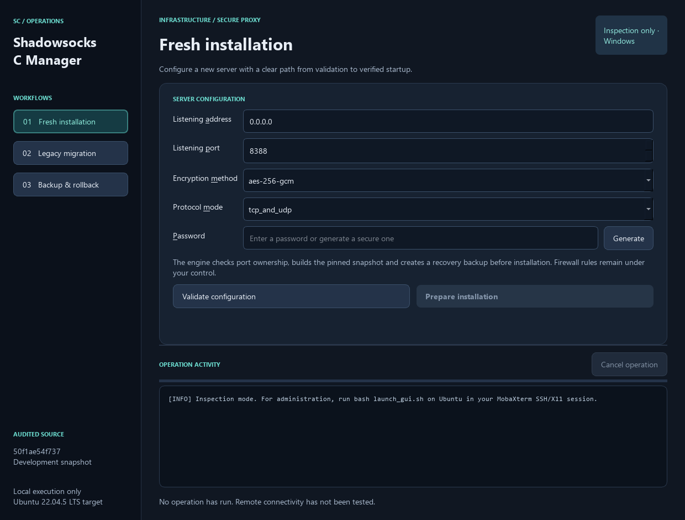

# Shadowsocks-C Manager

A local Ubuntu administration engine in Bash, with a Python/Qt operations
console. Three primary workflows: **Fresh Installation**, **Legacy Migration**,
and **Backup & Rollback**.



An offline interactive [HTML5 operator guide](https://michele-tn.github.io/SHADOWSOCKS-C-MANAGER/) covers the
MobaXterm SSH/X11 setup, all three workflows and twenty troubleshooting cases.
Open the HTML file directly in a browser; no guide server is required.

## Deployment status

Version 0.1.1 is an implementation for isolated deployment evaluation. The
configuration/backup components and mocked workflows have automated tests.
**A real Ubuntu installation, cutover, rollback and client relay have not been
executed in this Windows development environment.** See
[testing documentation](docs/TESTING.md).
Do not treat source review or mocked tests as production certification.

Target: Ubuntu Server **22.04.5 LTS**, running systemd, x86_64 or aarch64.
Python >=3.10. The intended GUI launch is **on the Ubuntu server through an SSH
session with MobaXterm X11 forwarding**. Python, Bash and all operations run on
Ubuntu; Windows displays the forwarded window. The application does not create
a second SSH connection. The pinned Qt GUI supports Jammy x86_64; ARM64 retains
CLI support because the Qt ARM64 wheel requires glibc 2.39, newer than Jammy.

The audited upstream commit is
`50f1ae54f737aa66f8edba05bdbf7250ff7f8a60`. It is a development snapshot,
not the published v3.3.6 release. The engine requires explicit `SNAPSHOT`
acknowledgement before building. It never follows master automatically.

## Optional Windows-only configuration inspection

Install Python 3.10 or newer, then double-click `launch_gui.cmd`. First launch
creates a project-local venv and installs pinned GUI dependencies from PyPI.
Or use PowerShell:

```powershell
python -m venv .venv
.\.venv\Scripts\python.exe -m pip install -r requirements-gui.txt
.\.venv\Scripts\python.exe launch_gui.py
```

The Windows console lets you configure/validate a new profile, generate a
masked random password, and inspect a legacy JSON file. Administrative buttons
are disabled because Windows cannot manage the target's systemd instance.

## Ubuntu installation

Extract the project into a trusted root-owned location, e.g.
`/opt/shadowsocks-c-manager`. Do not run privileged code from a shared writable
directory. Review scripts before execution. Install the Python venv prerequisite
from Ubuntu's official repositories if absent:

```bash
sudo apt-get install --no-install-recommends python3-venv
sudo chown -R root:root /opt/shadowsocks-c-manager
sudo chmod -R go-w /opt/shadowsocks-c-manager
cd /opt/shadowsocks-c-manager
sudo bash scripts/setup.sh
sudo bash shadowsocks-c-manager.sh
```

The setup installs Python validation dependencies in `.venv`, not system Python.
Build packages are checked individually; missing ones require `DEPENDENCIES`
consent. No unrelated package upgrades or removals are requested.

For the **MobaXterm SSH + X11 GUI**, enable X11 forwarding in the SSH
session and start MobaXterm's X server. From that original SSH shell:

```bash
sudo bash scripts/setup.sh --gui
bash launch_gui.sh --check
bash launch_gui.sh
```

The GUI setup installs missing Ubuntu X11/Qt runtime packages and the pinned
Python GUI dependencies. It can add GUI support to the existing verified venv.
The launcher probes the session display, requests sudo when necessary and
passes only the display and authority-file location into a clean root environment.
It checks root access again, verifies the trusted installation and checks Qt/xcb
dependencies before opening the window. Do not start with sudo -i or manually
replace DISPLAY; run the launcher from the original forwarded session.
No full Ubuntu desktop is needed. No xhost access-control changes, cookie output,
new SSH service configuration or application web listener are introduced.
See [X11/MobaXterm setup and troubleshooting](docs/X11_MOBAXTERM.md).

## CLI usage

```bash
sudo bash shadowsocks-c-manager.sh install                 # interactive wizard
sudo bash shadowsocks-c-manager.sh install /root/server.json
sudo bash shadowsocks-c-manager.sh migrate                 # discovers live source
sudo bash shadowsocks-c-manager.sh backup
sudo bash shadowsocks-c-manager.sh list
sudo bash shadowsocks-c-manager.sh rollback /var/backups/shadowsocks-c/BACKUP_ID
bash shadowsocks-c-manager.sh diagnose
```

Normal interactive operation has exactly three top-level choices. Commands
provide shortcuts within those modes. Installation, migration and restore use
exact typed `INSTALL`, `MIGRATE` and `ROLLBACK` confirmations. Ctrl-C or GUI
Cancel requests termination and, after cutover begins, snapshot recovery.
SIGKILL and power loss cannot execute traps; the recovery pointer remains in
`/var/lib/shadowsocks-c-manager/pending` and blocks new installs/migrations.

## Supported profile

Single literal IP, port 1024–65535, nonempty password, one reviewed AEAD cipher:
aes-128-gcm, aes-192-gcm, aes-256-gcm, chacha20-ietf-poly1305. Modes:
tcp_only, tcp_and_udp, udp_only. Positive integer timeout is supported.
Only these JSON fields are accepted. Arrays, low ports, plugins, ACLs, DNS
options, stream ciphers, symlinked paths, drop-ins and runtime overrides require
manual review and are rejected. No field is silently discarded.

Migration requires one active simple service with an explicit resolved
`/usr/bin/ss-server -c /etc/shadowsocks-libev/NAME.json` invocation, no
environment files/hooks/drop-ins, one source JSON and one running server
process. The stock default unit using `$CONFFILE $DAEMON_ARGS` is deliberately
blocked. See [migration guidance](docs/MIGRATION.md).

## Files and recovery

The manager uses its own executable `/opt/shadowsocks-c/bin/ss-server`,
config `/etc/shadowsocks-c/config.json` (0600), provenance and dependency
notices under `/opt/shadowsocks-c`, and a separate
`shadowsocks-c-manager.service`. The daemon uses systemd DynamicUser and
LoadCredential; it needs no low-port capabilities. Vendor units and the old
binary/package/configuration are retained. Migration disables the old unit's
boot activation only after the new service passes local health checks.

Snapshots are private directories in `/var/backups/shadowsocks-c`. Checksums,
metadata and service state are verified before restore. Legacy evidence is
read-only and must still match; restore never overwrites an edited source.
See [backup and rollback](docs/BACKUP_AND_ROLLBACK.md).

APT changes and source build artifacts are not rolled back. Empty manager-created
directories may remain after recovery. No backup is automatically deleted.
Checksums detect corruption, not malicious root modifications.

## Verification and limits

Health checks cover schema, executable, unit validity, process identity,
service state, selected socket ownership and journal error entries. A local
listening UDP socket does not prove UDP relay. No remote connectivity or cloud
firewall configuration is inferred. Firewall rules are never modified.
Review [security](SECURITY.md), [troubleshooting](docs/TROUBLESHOOTING.md),
and [testing documentation](docs/TESTING.md).

```bash
.venv/bin/python -m pip install -r requirements-dev.txt
bash scripts/run_tests.sh
```

Modules: `lib/` privileged workflows, `scmanager/` validation/snapshots/GUI,
`tests/` isolated fixtures and Bash recording doubles, `docs/` architecture and
operations, `scripts/` setup and development checks. Source license: MIT, see LICENSE.
Upstream and Qt retain their own licenses; no upstream executable is distributed
in this source archive.
